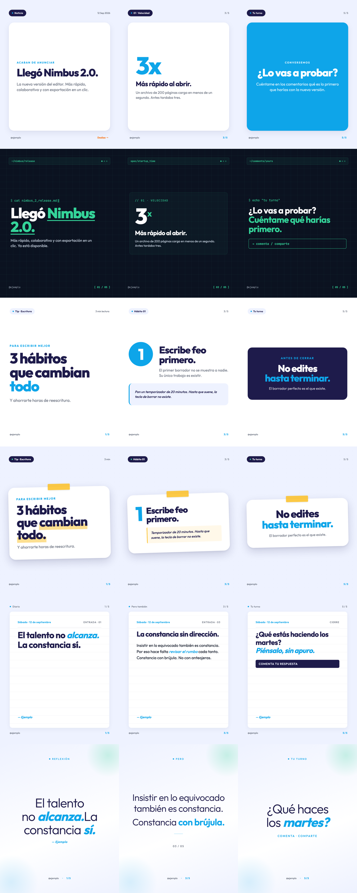

# Instagram Carousel Skill

Skill de [Claude Code](https://docs.anthropic.com/en/docs/claude-code) para generar carousels de Instagram desde un tema. Le pedís "hacé un carousel sobre X", te propone el texto slide por slide, lo aprobás y te deja los PNG (1080×1350) listos para subir.

> **English:** a Claude Code skill that turns a topic into an Instagram carousel. Claude proposes the copy slide by slide, you approve, it renders pixel-perfect PNGs with one of 6 HTML templates via [Open Carrusel](https://github.com/Hainrixz/open-carrusel). Works in any language: the instructions are in Spanish, the output follows your prompt.



## Qué hace

1. Detecta el formato del pedido: **noticia**, **tip** o **reflexión**.
2. Elige un template (6 incluidos, 2 por formato).
3. Propone el contenido en texto. Espera tu OK.
4. Renderiza los PNG con Open Carrusel (Puppeteer local, nada sale de tu máquina).
5. Guarda los PNG y el caption en una carpeta local.

No publica en Instagram. No genera videos.

## Requisitos

- [Claude Code](https://docs.anthropic.com/en/docs/claude-code)
- Node 20+ y Python 3.10+
- [Open Carrusel](https://github.com/Hainrixz/open-carrusel) clonado e instalado

## Instalación

### 1. Open Carrusel

```bash
git clone https://github.com/Hainrixz/open-carrusel ~/open-carrusel
cd ~/open-carrusel && npm install
```

La primera instalación baja Chromium (~300 MB) para Puppeteer.

### 2. El skill

```bash
git clone https://github.com/alandaitch/instagram-carousel-skill ~/.claude/skills/instagram-carousel
```

### 3. Configuración

```bash
cd ~/.claude/skills/instagram-carousel
cp config.example.json config.json
```

Editá `config.json`:

| Campo | Qué es |
|---|---|
| `handle` | Tu usuario de Instagram. Va en el footer de cada slide. |
| `signature` | Firma para los templates Diary y Soft Poetic (ej. `— Ana`). |
| `api_url` | Dónde corre Open Carrusel. Default `http://localhost:3000`. |
| `open_carrusel_dir` | Carpeta donde clonaste Open Carrusel. |
| `output_dir` | Carpeta donde se guardan los carousels. |
| `after_export` | Comando opcional tras exportar. `{folder}` y `{title}` se reemplazan. Ej. `open "{folder}"`. |
| `brand.font` | Google Font principal. Default `Outfit`. |
| `brand.font_mono` | Google Font monospace (Tech Terminal). Default `JetBrains Mono`. |
| `brand.primary` … `brand.neon` | Paleta. Ver tabla abajo. |

#### Paleta

| Clave | Uso |
|---|---|
| `primary` | Color de marca. Números, eyebrows, círculos, destacados. |
| `dark` | Headlines y fondos oscuros de cards. |
| `bg` | Fondo pálido de los slides claros. |
| `bg_dark` | Fondo de Tech Terminal. |
| `text` / `text_dim` | Texto principal / secundario. |
| `text_on_dark` | Texto sobre Tech Terminal. |
| `accent` | "Desliza →" en Card Pop. |
| `accent_yellow` | Cinta de Sticky Note, warnings en Tech Terminal. |
| `neon` | Accent de Tech Terminal, orbes de Soft Poetic. |

Los colores entran como variables CSS `--brand-*`. Cada template tiene un fallback neutro, así que podés dejar solo los que te importan.

## Uso

En Claude Code:

```
> hacé un carousel sobre los 3 hábitos que me ayudaron a escribir mejor
```

Claude responde con la propuesta: formato, template, chrome y el texto de cada slide. Le decís qué cambiar o "dale". Recién ahí genera los PNG:

```
Listo, "3 hábitos para escribir mejor" generado.

📁 Carpeta: ~/Carousels/3-habitos-para-escribir-mejor
🖼️ 6 slides PNG (1080×1350), 310 KB
📝 caption.txt incluido
```

Si querés que Claude escriba con tu voz, armá un skill de voz aparte (ej. `write-like-<tu-nombre>`) y mencionalo. El skill lo aplica encima de sus reglas de carousel.

## Los 6 templates

| Formato | Default | Alternativa |
|---|---|---|
| Noticia | **Card Pop** — fondo pálido, cards blancas, friendly | **Tech Terminal** — oscuro, monospace, vibe dev |
| Tip | **Numbered Steps** — blanco, círculos numerados, tutorial | **Sticky Note** — notas con cinta, artesanal |
| Reflexión | **Diary** — hoja con renglones, íntimo | **Soft Poetic** — gradient, una frase por slide |

Abrí cualquier `templates/*.html` en el navegador para verlo con 5 slides de ejemplo. Detalle de componentes en [references/templates.md](references/templates.md).

## Uso manual (sin Claude)

El script funciona solo. Armá un spec JSON (ver [examples/spec.example.json](examples/spec.example.json)) y corré:

```bash
bash scripts/ensure_server.sh
python3 scripts/publish_carousel.py examples/spec.example.json
```

Flags: `--overwrite` (regenerar en la misma carpeta), `--config <ruta>`.

## Estructura

```
SKILL.md                  ← instrucciones que lee Claude
config.example.json       ← copiar a config.json
templates/*.html          ← 6 templates con slides de ejemplo
references/templates.md   ← componentes CSS de cada template
references/writing.md     ← patrones de escritura para carousels
scripts/ensure_server.sh  ← levanta Open Carrusel si no está corriendo
scripts/publish_carousel.py ← spec.json → PNG
examples/spec.example.json
```

## Cómo agregar un template propio

1. Copiá uno de `templates/` y cambiá el CSS dentro de `<style id="slide-css">`. Dejá el bloque `preview-only` como está.
2. Usá `var(--brand-primary, #fallback)` para los colores que quieras controlar desde `config.json`.
3. Dejá `{{HANDLE}}` y `{{SIGNATURE}}` donde correspondan.
4. Agregá el tag a `VALID_TEMPLATES` en `scripts/publish_carousel.py` y una entrada en `references/templates.md`.

Escribí el nombre de la fuente sin comillas (`font-family: Inter, sans-serif`): el detector de Google Fonts de Open Carrusel no reconoce `'Inter', sans-serif`.

## Licencia

MIT.
